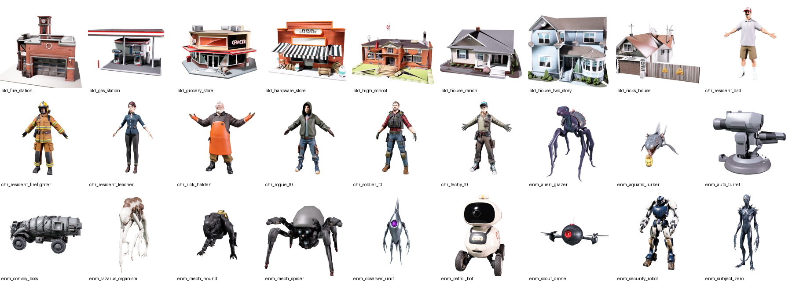
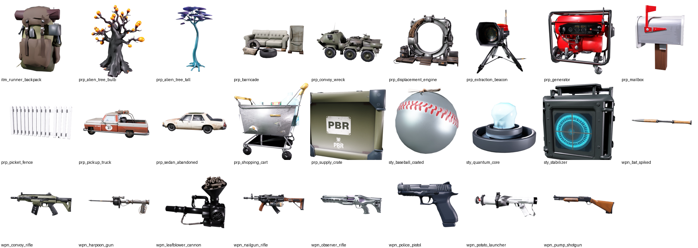

# Progress log

Everything that has been done on Rick's Parallel, in order, oldest first.

**If you are a contributor (human or AI): read this before you start, and add an entry at the bottom as part of your pull request.** This file is how the next person finds out what already exists, what was tried, and what is still broken.

## How to add an entry

Append a new numbered section at the end. Do not edit or reorder earlier entries, except to tick off an item in "Open problems" that your work fixed.

```markdown
## N. Short title (YYYY-MM-DD)

**Who:** your GitHub handle, and the AI tool you used if any
**What was done:** two to six bullets
**Where it lives:** paths in the repo
**Known problems / left unfinished:** be honest; this is the most useful part
```

---

## 1. First 3D asset plan (2026-11-10)

**Who:** @NewSoulOnTheBlock with Claude Code
**What was done:**
- Drafted a generic 3D model plan for a third-person extraction shooter: asset categories, counts, triangle budgets, pipeline and a four-week production order.
- Chose a browser-first target (Three.js) as the working assumption, with budgets to match.

**Where it lives:** superseded by entry 2; the current version is [docs/ASSET_PLAN.md](docs/ASSET_PLAN.md).

## 2. Story bible adopted, asset plan rebuilt around it (2026-11-10)

**Who:** @NewSoulOnTheBlock (story), Claude Code (plan)
**What was done:**
- The Rick's Parallel story and world bible became the canon for names, tone and campaign structure.
- Rebuilt the asset plan around it: three Runner classes, six gear tiers that follow the expeditions, five environment kits that cover all fifteen areas, ten hub buildings with bolt-on upgrades, and seven enemy families.
- Corrected the first plan: enemies are not all rigid machines; Lazarus and the Drowned District need skinned creature rigs.

**Where it lives:** [docs/STORY.md](docs/STORY.md), [docs/ASSET_PLAN.md](docs/ASSET_PLAN.md)

## 3. Repository opened in public (2026-11-10)

**Who:** @NewSoulOnTheBlock with Claude Code
**What was done:**
- Created this public repository and framed the project as an open AI social experiment anyone can join.
- Wrote the README (full game breakdown in 16 sections, plus the "point your AI at this" prompt), the contributing guide, and the folder skeleton.

**Where it lives:** [README.md](README.md), [CONTRIBUTING.md](CONTRIBUTING.md), `docs/`, `assets/`, `tools/`
**Known problems / left unfinished:**
- No license chosen yet.
- The engine and stack are proposed, not decided.
- No starter issues have been filed.

## 4. Model generation tooling and pilot (2026-11-10)

**Who:** @NewSoulOnTheBlock with Claude Code
**What was done:**
- Wrote a resumable batch generator for the Meshy API. Each model is a Smart Topology preview at a set triangle count, then a PBR texture pass: 15 credits per finished model.
- Wrote the first asset list: 53 models with a name, triangle budget and prompt each.
- Ran a two-model pilot (`chr_soldier_t0`, `prp_mailbox`) to confirm cost and quality before spending the rest.

**Where it lives:** [tools/meshy-batch.mjs](tools/meshy-batch.mjs), [tools/asset-batch-01.json](tools/asset-batch-01.json)

## 5. First model batch: 53 models (2026-11-10)

**Who:** @NewSoulOnTheBlock with Claude Code. All 53 models are AI-generated with Meshy (`meshy-t2.5` geometry, `meshy-7` textures) from the prompts in the asset list.
**What was done:**
- Generated 7 characters, 9 weapons, 12 enemies, 8 hub buildings, 13 props and 4 story items or gear. 795 credits spent.
- Characters are in an arms-out pose ready for rigging.
- Reviewed every model by thumbnail only.




**Where it lives:** `assets/models/*.glb`, thumbnails in `assets/models/thumbs/`, and every prompt and task id in [assets/models/manifest.json](assets/models/manifest.json)
**Known problems / left unfinished:** see "Open problems" below.

## 6. Models compressed and committed (2026-11-10)

**Who:** @NewSoulOnTheBlock with Claude Code
**What was done:**
- Wrote a texture compressor for GLB files (Python and Pillow, no other dependencies). It resizes and re-encodes embedded textures and leaves geometry untouched.
- Compressed the batch from 371 MB to 45.5 MB: characters keep 2K textures, everything else is 1K, all JPEG at quality 82.
- Output is plain glTF 2.0 with no extensions, so any loader opens it.
- Added this progress log and wired it into the AI contributor prompt.

**Where it lives:** [tools/compress-glb.py](tools/compress-glb.py), `assets/models/`
**Known problems / left unfinished:**
- The uncompressed 2K originals are not in the repository (too large). They exist only on the maintainer's machine.
- Geometry is not yet compressed (no meshopt or Draco), and textures are JPEG, not KTX2 as the asset plan targets.

---

## Open problems

Tick an item when your pull request fixes it, and say so in your entry.

### Models that need to be redone
- [ ] `prp_supply_crate`: the letters "PBR" are printed on it (a style word leaked from the prompt into the texture).
- [ ] `enm_convoy_boss`: came out as an armoured tanker truck, not a burrowing machine fused with one. Probably needs two parts combined by hand.
- [ ] `wpn_nailgun_rifle`: looks like a conventional assault rifle, not an improvised nail gun.
- [ ] `wpn_bat_spiked`: thin and stick-like; does not read as a baseball bat.

### Models that need touch-ups
- [ ] `bld_grocery_store`: garbled sign text ("GRACER").
- [ ] `enm_alien_grazer`: reads as a predator, not a docile grazer. Either redo it or rename it and use it as a different creature.
- [ ] `sty_quantum_core`: the crystal sits on a base instead of floating inside rings.
- [ ] `sty_baseball_coated`: the attached note is barely visible.
- [ ] All `bld_*` models carry a small ground slab that should be trimmed.

### Not yet done for any model
- [ ] **Scale:** every model is normalised to roughly one unit across. None are at real-world scale (1 unit = 1 m) yet.
- [ ] **Mesh check:** nothing has been opened in a 3D tool. Topology, normals and UVs are unverified.
- [ ] **Rigging:** no character is rigged or animated.
- [ ] **Machine parts:** enemy machines are single meshes. The plan calls for separate named parts so armour can be shot off.
- [ ] **LODs:** none exist.
- [ ] **Modular environment kits:** not started. These are meant to be hand-modelled so they snap to the 4 m grid.

### Project decisions still open
- [ ] Choose a license for code and for art.
- [ ] Decide the engine and stack.
- [ ] File starter issues from the README roadmap.
